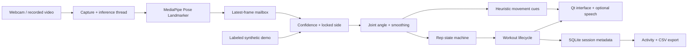

# Project evaluation

## Problem statement

Develop an accessible computer vision system that uses an ordinary camera to track selected exercise movements, count completed repetitions and provide immediate movement guidance without wearable sensors. The implemented system supports five manually selected exercises, set planning, visual feedback and session review.

## Architecture

The GUI polls a single-frame mailbox, avoiding a growing queue of stale camera frames. Recorded video waits until the GUI consumes each decoded frame. Pose estimation stays on a worker thread, while all widget operations and SQLite writes occur on the GUI thread. Sessions use deterministic lifecycle transitions and transactional storage. Database connections and camera handles are explicitly closed.

## Evidence currently available

Automated tests verify deterministic behavior on generated input. The video integration test uses the actual model on blank frames and checks capture completion, no detected body and file-handle release. It verifies integration, not human pose accuracy. Offscreen screenshots verify desktop layout and demonstrated workflows. No real-person recognition or coaching accuracy results are available yet.

## Collect evaluation data

1. Record separate side-view clips for each exercise and anatomical side. Keep the working joints visible.
2. Include complete repetitions, partial movements, pauses, brief occlusion, leaving frame and deliberately different camera angles.
3. Include multiple consenting participants, clothing and lighting conditions. Record camera height, distance, resolution and hardware.
4. Label full-rep completion timestamps manually. For form cues, define the exact visible condition first and have a qualified exercise reviewer label it separately.
5. Use one group of recordings to tune angle thresholds and another held-out group to evaluate them. Do not tune on evaluation clips.

## Report meaningful results

- Absolute rep-count error per clip, and mean absolute count error per exercise.
- Matched/missed/extra rep events using a documented timestamp tolerance; report precision and recall where event labels exist.
- Cue-specific precision and recall against reviewed form-condition labels. Do not equate angle-endpoint completion with correct form.
- Inference latency and effective playback/camera FPS on named hardware.
- Failures stratified by camera placement, visibility, participant and exercise.
- How often tracking pauses and whether an interrupted partial repetition is incorrectly counted.

Keep a results table with columns: clip ID, exercise, participant code, side, lighting, camera placement, manual reps, predicted reps, absolute error, missed reps, extra reps, latency and notes. Report observed values only. Do not insert simulated numbers into project findings.

## Release acceptance checklist

- Webcam starts on the intended laptop and releases when finished or closed.
- All five profiles are evaluated against manually labeled clips.
- Pause and rest do not count movements; changing side cannot bridge half a rep.
- Recorded videos pause during countdown/rest and finish cleanly at EOF.
- Voice cues work with the target computer's installed voice, or remain disabled.
- History survives restart and CSV opens correctly.
- Small-screen layouts remain scrollable with all controls reachable.
- Limitations are visible in the guide and are reflected in the college report.
